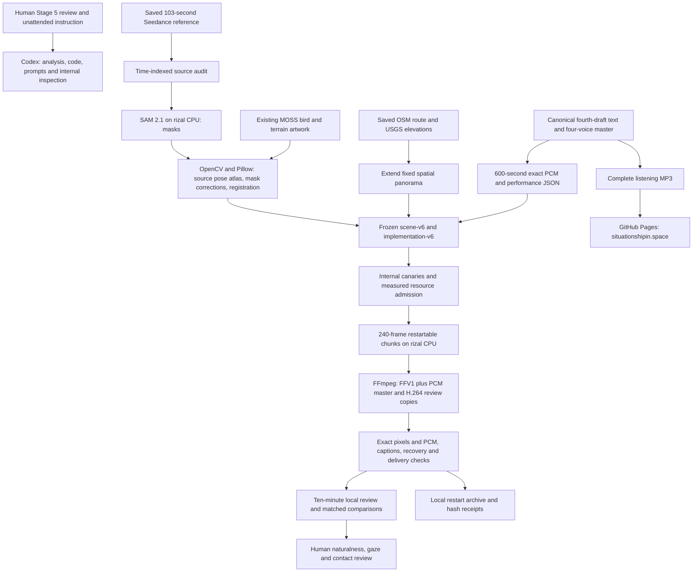
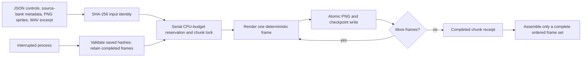

Revisions from:
20261029.local_rendering_exploration_stage_4.md

Human review of the latest video, the 5 minute render is:

1. Gait, leg and body animation, animated leg and torsomotion, the albatross landing and then takeoff is very alkward with the leg and feet motion. All animal motion with connections of legs to torson on all animals: weak. Re-evaluate the seedance-generated stage 4 outputs again, in fine detail. How can the local render match that quality? Generate a plan for improvement.

2. Evaulate using seedance2.ai credits in November to produce gait, leg and body animation cutouts, face left/right/center profiles, up, down, etc. Could this be used with the existing stage-4 rendering pipeline to improve gait/motion animation?

3. foreground, background, all good, scrolling works, location tracking: all good

4. other naimals animations good

5. mouth motions are pretty good, especially for dog and albatross. Cat could use some work, but this is progressing much faster and better than gait.

6. gaze, animal attention, facial position: all weak. Scaling and warping on the dog is common, any head movement is a warp and distortion instead of a movement through head positions. Think about what kind of profile information would allow better head animations, and plan a prompt to generate the profiles with seedance.

7. Legs on the animals are not really rendering well. The for the dog, the front paws get distorted when the animations overlap, and the back leg is revealed to be a stick leg, and not even an animal leg. The horse legs are not proportioned to the body of the horse, and look like the horse is falling over. Re-track the canonical seedance 4 leg motion and shapes. Redo this.

Make these changes, and render out the first 10 minutes for stage 5.

Append any production notes, audits, suggestions for improvement. Put in the docs the fully-rendered audio track, and put that audio rendering up on situationshipin.space for review and script improvement.

---

## Current production — November 1, 2026

November 17 review publication: [complete local film, 52:35](https://situationshipin.space/review/here-lies-trouble-local-full-20261117/),
[this Stage 5 record](https://situationshipin.space/review/here-lies-trouble-local-stage5-record-20261117/),
and [durable workflow](https://situationshipin.space/review/here-lies-trouble-local-stage5-workflow-20261117/).
The video is a complete 720p review derivative of the November 1 delivery,
with copied dialogue audio and optional English captions. Full-film human
review remains open; the published 103-second provider film is an earlier comparison.

The human-approved baseline is **opening-v7**. The complete 52:35.375 episode now uses that treatment.
Use the [Stage 5 durable workflow](20261030.local_rendering_exploration_stage_5_durable_workflow.md)
for current status, selected implementation, restart commands and review limits.
The October 30 record below describes the preserved opening-v6 baseline;
the October 31 review and revision are appended later in this file.

## Execution record — October 30, 2026

The text above is the human review and execution instruction, preserved as
received. The current instruction authorizes unattended implementation and a
600-second candidate. It does not mark that future candidate visually accepted.
This is local exploration Stage 5, distinct from the earlier production Stage 5
planning document and the hosted Seedance production Stage 4 reference.

### Scope and preserved components

- Preserve canonical fourth-draft words and the existing four-voice master.
- Preserve the reviewed foreground, illustrated OSM terrain, common scrolling
  clock, incidental animals, and useful dog/albatross mouth treatment.
- Replace the failing whole-body leg and head deformation approach after a
  detailed, time-indexed comparison with the canonical Seedance footage.
- Render the first 600 seconds at 1080×1920, 24 fps, with exactly 28,800,000
  stereo sample frames from the existing 48-kHz dialogue master.
- Keep opening-v5 and its archive immutable. New work lives in
  `outputs/here-lies-trouble/local-rendering-stage-5-performance-20261030/`.
- Evaluate November Seedance asset production and prepare prompts; do not
  submit paid jobs or buy credits as part of this evaluation.
- Publish a bounded complete audio listening derivative on the existing
  situationshipin.space review portal, retaining the full lossless master locally.

### Implementation sequence

1. **Reference audit:** inspect the 103-second clean Seedance reference,
   including individual walking phases, anatomical silhouettes, head views and
   occlusions. Preserve source times, masks and limitations.
2. **Pose-library experiment:** test complete, matted animal poses extracted
   from existing reference footage. A pose library can retain source anatomy
   that a single-image skin mesh cannot reconstruct. Reject poor mattes,
   occluded limbs and discontinuous loop boundaries before production selection.
3. **Performance revision:** register independent head views at the neck;
   preserve head aspect ratio; attach anatomical mouths to their selected view.
   Use forward attention as neutral and explicit partner targets. Rework bird
   approach, foot reach, contact, crouch, push-off and departure as separate phases.
4. **Integration canaries:** compare opening, speaking, gait, head direction,
   landing and loop seams against v5 and the source at matched times. These are
   internal checks under the unattended instruction; record actual limitations
   and leave human naturalness/readability acceptance pending.
5. **Ten-minute production:** extend scenery coverage and the measured dialogue
   control timeline, freeze source/implementation hashes, render restartable
   chunks, assemble exact PCM/lossless picture and review proxies, verify and
   record recovery evidence. Test measured runtime against the remaining shared
   CPU-worker allowance before admitting the full run; no allowance reset.
6. **Audio and handoff:** publish the complete listening track, verify the live
   review URL, save resource/source receipts, append implementation details and
   remaining review issues here, and update project state.

### Initial root-cause findings

V5's geodesic weights preserve connected alpha, but cannot reconstruct an
occluded rear leg or the changing silhouette of a paw from a single source
pose. Connected pixels did not establish anatomical quality. Its two-segment
limb targets also simplify the equine fetlock and canine/feline hock. Head
foreshortening changes width without supplying the far eye, muzzle, ear or
neck surfaces revealed by a real turn. The bird's former landing moves feet
between points without a coordinated pelvis/knee/ankle and body impulse.

The new source-pose experiment addresses these representation limits rather
than treating a larger pixel difference as evidence of better animation.
Actual source coverage, matte quality and temporal continuity still require
inspection; the existing reference cannot supply unseen views automatically.

### Starting resource state

The shared CPU ledger begins at 11,729.382 / 21,600 worker seconds, leaving
9,870.618 seconds. The earlier image/training allowances are exhausted;
no new MOSS sampling or training is planned. Frame-pose caching and one
persistent renderer per chunk will be measured before the ten-minute run.
Preparation, source analysis, audio publication and encoding overhead are
recorded separately where the existing ledger does not charge them.
For this run the ledger charges frame workers, technical preflight,
master/proxy encoding, exact-media verification and restart proofs. Source
segmentation, interactive assembly inspection, site publication, review-only
derivative encoding and archive construction remain preparation/delivery
work outside that inherited worker allowance; their receipts retain timings
where measured.

### October 30 production selection — preserved opening-v6

The candidate selected on October 30 was **opening-v6**. Its immutable scene and renderer
were frozen after 624 internal canary frames and source/performance checks.
Production completed in 60 restartable 240-frame chunks. The authoritative progress files
are `opening-v6/readiness.json`, `opening-v6/heartbeat.json` and the root
`continuation.json` under the Stage 5 output directory. The completion and archive receipts below record the final verified result.

The selected input identity is
`cd765879c17775c20801eee70080c6fe805d05a172bb7ae00cd18baea2c63219`.
This pins the compiled assets, performance, source excerpt, input receipts and
all eleven frozen Python files. Do not edit those files in place. A changed
candidate needs a new run, scene and implementation identity.

### Complete audio for script review — published

Listen to the [complete fourth-draft audio review](https://situationshipin.space/review/here-lies-trouble-draft4-complete-audio-20261030/)
and read the [matching canonical screenplay](https://situationshipin.space/review/here-lies-trouble-fourth-draft-20261026/).

The existing master contains **52:35.375 of complete dialogue**. No words,
voices, pauses or ordering were edited for this publication. The listening
file is a mono 24-kHz, 40-kbit/s MP3 derivative, 15,777,591 bytes. The full
lossless stereo 48-kHz, 24-bit WAV remains available locally:

[Complete lossless dialogue master](../../../outputs/here-lies-trouble/stage-4-20261026-option-b-v3/dialogue-master.wav).

| Artifact | SHA-256 |
|---|---|
| Complete lossless master | `efc0ad9a7bdf1bd39a47003db860c4efc9d6659b912e6c32d22f66aa1d000cec` |
| Complete listening MP3 | `8608e5939b15fc9d814f3425284c45391a5e5a75eb9adb2c44ba7bd2cda8c3ce` |
| Canonical fourth-draft source | `889c2fdd91008e7acd998a7ed1ab94c4a0a20e71c5cba06ec37070e47001f4f6` |

The MP3 decodes to exactly **75,729,000 mono sample frames at 24 kHz**,
preserving the full duration. Its unshifted waveform cosine against the
downmixed source is 0.990811. It is a lossy listening copy, not PCM-identical
to the master. Detailed receipts are in `audio-review/verification.json` and
`audio-review/publication-live.json`.

The existing situationshipin.space GitHub Pages workflow published commit
`99f3696`. Live page and media requests returned HTTP 200, and the downloaded
media hash matched the local MP3. Publication used an isolated temporary
checkout based on the latest remote main. The site payload allowance was
raised from 256 to 272 MiB for this one 15.8-MB audio file; its 16-MiB per-file
limit remains enforced. Site validation passed with 865 catalog items and
3,646 referenced paths. The publication does not mark the script, voices or
new picture human-approved.

### Detailed reference reassessment

The clean 103-second reference is
`outputs/here-lies-trouble/stage-4-20261026-option-b-v3/review/sequence-silent.mp4`.
The `reference-audit/` directory preserves the overview, quarter-second gait
crops, time-indexed head coverage, mask failures and enlarged mouth/ear
registration images.

The reference's changing limb silhouettes already contain the shoulder,
elbow, hock, fetlock and paw/hoof shapes that v5's single-image mesh lacked.
Its actual head turns reveal a second eye, different ear overlap and muzzle
foreshortening. Those surfaces cannot be supplied by narrowing a side-view
image. The revision therefore uses **complete walking poses plus separate
registered source head views**. It retains the existing generated bird and
scenery artwork, and does not perform new MOSS generation or LoRA training.

| Animal | Walking source selection | Output cycle | Head-view source selection |
|---|---|---:|---|
| Unicorn | Reference frames 0–21, 0.000–0.875 s | 40 frames / 1.667 s | Frames 48–72, 2.000–3.000 s; 25 views |
| Dog | Frames 11–28, 0.458–1.167 s | 35 frames / 1.458 s | Frames 1710–1728, 71.250–72.000 s; 19 views |
| Cat | Frames 266–276, 11.083–11.500 s | 18 frames / 0.750 s | Frames 1152–1176, 48.000–49.000 s; 25 views |
| Albatross | Existing selected MOSS bird and retained wing system | Intermittent flight beats | Existing head/beak layer, with rigid pitch and iris travel |

Source contact-foot displacement estimates were approximately 8, 8.5 and
7 source pixels per frame for unicorn, dog and cat. The selected retiming
produces approximately 105.6, 104.9 and 102.7 pixels/s during stance, close to
the shared 105-pixel/s world travel. These are source-image estimates and
authored retiming, not recovered three-dimensional biomechanics. The horse
has the slowest cycle and the cat the fastest.

The original source dog obscures parts of the unicorn's rear legs; the cat's
tail crosses a front fetlock. Reusing independently timed mattes exposes those
holes. The preparation code explicitly completes short missing sections
between existing limb surfaces, using their endpoint colors and local width.
It records each completion polygon in the source-bank manifest. This is
**authored completion of hidden pixels**, not observed anatomy. Tiny detached
mask flecks are removed. Those repairs remain a visual review concern and a
reason to acquire unobstructed November source clips.

### Segmentation, masks and rejected experiments

Classical GrabCut and optical-flow mask propagation were tested first.
Loose masks captured scenery/shadows or neighboring animals; tight masks
removed feet and ears. Those experiments remain in `pose-experiments/` and
`pose-experiments-v2/` and are excluded from the selected scene.

SAM 2.1 hiera small produced the selected prompt-guided masks. Its source
and checkpoint are Apache-2.0 licensed; the optional CUDA post-processing
extension was not needed for this CPU extraction path.
[Official SAM 2 repository](https://github.com/facebookresearch/sam2).

- Source revision: `2b90b9f5ceec907a1c18123530e92e794ad901a4`.
- Checkpoint: `sam2.1_hiera_small.pt`, 184,416,285 bytes.
- Checkpoint SHA-256:
  `6d1aa6f30de5c92224f8172114de081d104bbd23dd9dc5c58996f0cad5dc4d38`.
- Configuration: `configs/sam2.1/sam2.1_hiera_s.yaml`.
- Inference device: **CPU on rizal**. CUDA was unavailable in this execution
  environment; the historical NVIDIA machine configuration is not evidence
  that this extraction used the GPU.
- Extraction runtime: the existing Python 3.12.16 / Torch 2.14.1+cu130 runtime,
  with additional dependencies isolated under the Stage 5 `python-packages/`.
  The older MOSS environment was not modified.

The selected extraction script is `scripts/hlt-local-stage5-sam.py`. Each
source bank records source frame/time, crop, original image hash, model hash,
mask area and predicted IoU. Predicted IoU is a model estimate, not a human
quality score. The dog ears needed further restoration: source RGB inside
traced ear interiors replaces SAM's holes where black ears met the black
unicorn. That correction does not draw a new dog identity.

`reference-audit/extraction-inputs.json` records the original per-bank boxes,
positive/negative points and settings. The opening bank used two dog-positive
points; the later head bank added an ear point. The final extraction script
contains that later default, so do not assume re-running it unchanged recreates
the earlier prompt configuration. Exact replay uses the stored masks and
compiled sprites, whose hashes are preserved.

### Head, mouth and body integration

`source-pose-bank.json` records the complete compiled body cycles, real head
views, original source rows, neck anchors and per-view eye/lower-lip landmarks.
Body temporal interpolation uses local optical flow between neighboring
source poses, including the loop join. It does not apply a skeletal whole-body
mesh to a single image. Alpha thresholds suppress translucent duplicate paws.

Head selection follows a smooth attention envelope but selects actual saved
views. Head width and height stay at **1:1 source scale**. Small pitch changes
are rigid rotations around the registered neck, not nonuniform head warps.
The dog uses a stronger partial turn for companions ahead, and a fuller turn
for partners behind. All animals return to a forward neutral view between
glances. The current source library covers side-to-front; opposite-side and
full up/down views remain missing.

The initial integration exposed a horizontal transparency seam: two half-alpha
neck mattes do not sum to opaque coverage under normal alpha compositing.
The selected implementation retains an opaque 24-pixel source-neck overlap
under the feathered head. Source translation occurs before the final head
cut, keeping the seam in the body coordinate system.

Mouths use the actual selected view's lower-lip endpoints. Unicorn landmarks
are below the nostrils; cat landmarks follow the short lower jaw and paired
frontal muzzle. A short local jaw displacement and clipped cavity respond to
the existing audio envelope. The albatross retains its accepted beak layer.
Only the active canonical speaker's mouth opens, with silence hysteresis at
RMS 0.003/0.006. This remains energy-driven articulation, not phoneme visemes.

The voice mapping is unchanged:

| Speaker | Animal | Voice |
|---|---|---|
| 1 | Unicorn | `af_bella` |
| 2 | Dog | `am_echo` |
| 3 | Albatross | `af_nicole` |
| 4 | Cat | `af_heart` |

### Albatross contact revision

The albatross keeps its reviewed flight artwork and basic wing motion. The
49–59.5-second event now has separate approach, ride, crouch, push-off and
departure states. Feet move forward during braking, then settle under the
body. The contact point follows the actual upper contour of the current
unicorn pose at the saddle region.

| Time | State |
|---|---|
| Before 49 s | Flight, trailing feet |
| 49–51.5 s | Approach; feet reach forward and settle |
| 51.5–56.3 s | Ride; planted toes follow the moving back contour |
| 56.3–56.8 s | Crouch; body descends while feet stay planted |
| 56.8–57.15 s | Push-off; leg extension lifts the body from planted toes |
| 57.15–59.5 s | Departure; wings beat and feet retract |
| After 59.5 s | Flight |

Beyond the available 103-second reference, bounded wingbeat windows recur
every 18 seconds. This is an authored extension. The candidate includes the
one explicit back-riding event above; it does not claim a new observed flight
trajectory for the remaining seven-plus minutes. Folded-wing shape and the
naturalness of toe/ankle motion remain human review items.

### Preserved scenery and long-duration extension

The first 32,860 columns of the accepted v5 panorama are byte-for-byte
identical in the extended atlas, preserving every terrain pixel used through
the first 300 seconds. The atlas extends to **67,072 × 1,280 pixels**, using
the same saved illustration materials, spatial quilting, OSM route geometry
and USGS height trend. Camera position is `round(280 + 105 × seconds)`.
Ground, terrain and foreground use the same 105-pixel/s travel clock.

There are no timed scene dissolves. The sky motif remains fixed as before.
The saved first-103-second actor staging is retained as position offsets;
after that, the final formation is held while the scenery continues. At
600 seconds, the illustrated route progress is approximately 428.3 metres.
Texture reuse and an approximate skyline remain inherent in this illustrated
method; no exact photographic terrain reconstruction is claimed. No Google
imagery or new Google mapping data were used.

Incidental animal drawing code and event inputs are retained. The accepted
foreground artwork is hash-identical to v5. The existing visitor schedule is
not silently replaced with additional events during the extended duration.

### Internal canary and preflight evidence

Five canary intervals covered 624 frames: 0–6, 18–21, 30–33, 42–45 and
49–60 seconds. Their frame-worker time was **154.691 seconds**, or
0.247902 seconds per frame; the measured full-frame projection was
3,569.788 seconds before assembly and verification. The canaries remain in
`opening-v6-dev/jobs/canaries/`, with opening and landing/takeoff MP4s in its
`review/`. The final candidate slightly strengthens the dog's turn and has
its own frozen identity and final preflight.

Final preflight checks establish exact canonical PCM extraction, four actors,
speaker-only mouth activity, covered terrain positions, the preserved first
300-second panorama and an exact 105-pixel translation from seconds 5 to 6
inside opaque terrain. They also inspect all body-cycle silhouettes and
record actual head-view/mouth landmark coverage.

| Actor | Sample time | Mouth-changed pixels in actor crop | Attention-changed pixels in actor crop |
|---|---:|---:|---:|
| Unicorn | 1.167 s | 441 | 22,455 |
| Dog | 19.208 s | 536 | 7,198 |
| Albatross | 31.083 s | 397 | 1,844 |
| Cat | 42.625 s | 299 | 6,360 |

These ablations prove that the selected controls affect the intended actor's
image. They do **not** prove natural performance or correct perceived gaze.
The loop-join image-difference ratios relative to each cycle's median adjacent
change are 2.584 for unicorn, 1.539 for dog and 0.976 for cat. The unicorn's
join deserves particular normal-speed review. The comparison image and full
measurement details are in `opening-v6/review/performance-verification.json`
and `four-speaker-performance.jpg`.

A follow-up occlusion audit found a residual unicorn hoof fragment in cycle
phases 25 and 26 (183 and 152 pixels). The actual dog matte fully covers it
in 707 of the 720 occurrences across ten minutes. Thirteen early frames expose
some pixels; the clearest cases are **2.708–2.750 seconds** and
**4.375–4.417 seconds**. This is a remaining source-matte/occlusion defect,
not a fully resolved anatomical surface. Its exact frame list is saved in
`opening-v6/review/occluded-component-audit.json`. Include these moments in
human review; the connected-component checks do not justify claiming that
every unicorn leg is seamless. Dog and cat body cycles had no additional
components above the 100-pixel audit threshold.

Production stills at 420, 480, 540 and 599.958 seconds confirm continued scene
coverage and the retained cast. The last sample also exposes **residual
interpolation ghosting of a unicorn lower leg near the loop wrap**. Silhouette
connectivity and alpha thresholding have not eliminated every translucent
double edge. Inspect `production-late-performance.jpg` and the normal/half-speed
gait review before accepting this treatment. The candidate improves source
anatomical coverage but does not establish Seedance-equivalent temporal quality.

### November credits and source-clip prompts

Use the [November asset acquisition plan](../../../resources.static/here-lies-trouble/local-rendering-stage-5/november-asset-acquisition.md)
for ready-to-review gait, yaw, pitch and landing prompts; seeds; source
references; import metadata; and staged human review gates.

A new authenticated balance check still reports **40 credits**. A November 1
refill is not confirmed. The conditional plan allocates 78 seconds of selected
first attempts plus an 18-second bounded retry reserve. At the project's old
60-credit/s rate, that totals 5,760 credits. It requires a current quote,
verified renewal and separate spend authorization. No paid jobs, subscriptions
or purchases were submitted during this local Stage 5 work.

### Software, hosts, AI and data flow





The render host is **rizal**, Fedora Linux 7.2.11, Python 3.14.8, NumPy 2.4.6,
SciPy 1.16.2, Pillow 12.3.0, OpenCV 4.13.0 and FFmpeg/FFprobe 8.1.3. The
selected environment and eleven Python source hashes are saved in
`runtime-environment.json` and `implementation-manifest.json` in the run's
`review/` directory. Old dependency module docstrings describe their original
v4 behavior; the selected Stage 5 entry point is `hlt_local_stage5_art.py`,
which does use compiled reference-derived poses.

Codex authored and inspected the implementation. SAM supplied segmentation,
not new artwork. Saved Seedance footage supplied quadruped appearance and
motion views; earlier MOSS artwork supplied the retained bird/scenery. No new
speech, still generation, training or hosted video generation occurs during
the ten-minute render. There is **no database server**: data and state are
files—JSON, PNG, WAV, MP4, MKV, hashes and a tar archive.

### Restart and evolution instructions

Work from `/home/bkoz/src/izzi`. Start by reading this document and
`outputs/here-lies-trouble/local-rendering-stage-5-performance-20261030/continuation.json`.
Do not start a second worker if the heartbeat is current and its process is
alive. Chunk locks and the shared CPU lock reject concurrent admission.
The recorded PID is local to this execution namespace; use the current job
session, timestamps and file locks to determine activity, rather than treating
that number as a host-wide process ID.

```bash
python3 scripts/hlt-local-stage5-run.py full
python3 scripts/hlt-local-stage5-run.py verify
python3 scripts/hlt-local-stage5-run.py recover
python3 scripts/hlt-local-stage5-deliver.py
python3 scripts/hlt-local-stage5-delivery-check.py
python3 scripts/hlt-local-stage5-state.py --final
python3 scripts/hlt-local-stage5-package.py
python3 scripts/hlt-local-stage5-state.py --final
```

`full` resumes incomplete chunks and validates completed PNG hashes. It then
assembles the master and verifies decoded frames in four 3,600-frame parts,
each inside the existing finite CPU reservation. `recover` deliberately stops
and resumes two separate 24-frame proof jobs, preserving completed frames and
checking them against production. It does not destroy production chunks.
Do not reset the inherited six-hour ledger at
`outputs/here-lies-trouble/local-rendering-stage-3-opening-20261028/cpu-budget.json`.

`opening-v6/inputs.json` selects `implementation-v6` and `scene-v6`; its
`assets` link points to `../scene-v6/assets`. Replaying the compiled scene
requires no SAM checkpoint, GPU, provider account or network. SAM and the
preparation scripts are needed only to revise source extraction. Exact output
should be checked against saved pixel hashes on a restored environment;
different image-library versions can change rasterization.

For another evolution, create new run/scene/implementation names. Copy the
canonical inputs and selected compiled assets, then change only the candidate
copies. Retain all source time/hash metadata, recorded completions and human
decisions. Acquire genuinely missing views rather than silently relabeling a
front view as an opposite-side profile. Re-run targeted gait, mouth, gaze,
landing and scene-continuity canaries before a longer job.

The archive is a local restart copy, not an independent-host backup. Its
external `bundle-verification.json` is authoritative for the final archive
hash; a bundle cannot include its own final hash. Preserve any newer CPU ledger
when restoring. Archive recipes include the canonical text/audio and reference
sources as well as compiled assets, frames, implementation and selected source
mattes. Existing earlier candidate archives remain untouched.

### Open decisions for human review

1. Do the complete source poses correct the stiff shoulder/hip and paw/hoof
   failures sufficiently? Inspect the unicorn's occlusion completions and
   loop boundary, residual interpolation ghosting, and any thin or irregular
   lower-leg sections.
2. Do real head-view changes read as attention to the intended partner?
   Inspect the dog's ear edges, view stepping and neck joins. The available
   footage does not provide true left profiles or comprehensive pitch views.
3. Are the cat and unicorn mouths clearly on the lower jaw across turns?
   Energy-based openings remain an approximation of speech articulation.
4. Does the bird's forward foot reach, contact, crouch and push-off feel
   coordinated? Inspect folded wings, toe contact and body lift at 49–59.5 s.
5. Does ten-minute playback expose distracting cycle repetition, fixed actor
   formation, occasional matte edges or spatial terrain texture reuse?
6. Which unobstructed source asset should receive the first future paid
   canary? The November document recommends dog gait first, followed by its
   head-view set, subject to actual available credits and review.

The human has accepted the inherited scenery/location tracking and incidental
animals. Technical checks and unattended execution do not approve the new
candidate's overall visual quality.


### Completed ten-minute production and delivery

Completed at 2026-10-31T01:03:00.220588+00:00.
Open the [ten-minute review player](../../../outputs/here-lies-trouble/local-rendering-stage-5-performance-20261030/delivery/opening-v6/index.html),
the [clean film](../../../outputs/here-lies-trouble/local-rendering-stage-5-performance-20261030/delivery/opening-v6/opening-clean.mp4),
or the [matched Seedance comparison](../../../outputs/here-lies-trouble/local-rendering-stage-5-performance-20261030/delivery/opening-v6/seedance-comparison-103s.mp4).
The player also provides captions, exact PCM, the lossless master, enlarged
speaking faces, landing/takeoff, five-minute continuity and a v5/v6 comparison.

- Picture: **600 seconds, 14,400 frames, 1080×1920, 24 fps**; all decoded
  lossless RGB frames match their production pixel hashes.
- Audio: exactly **28,800,000 stereo 48-kHz sample frames**, PCM-identical to
  the first ten minutes of the unchanged complete dialogue master.
- Captions: **1413 canonical tokens / 141 cues**; source offsets,
  words, punctuation, intervals and review links validated. The exact endpoint
  falls during “doesn't” in albatross/speaker 3 turn 33.
- Restart: two real interrupted/resumed 24-frame proof jobs, beginning at
  frames 1,200 and 4,800, preserve the first 12 saved frames and reproduce
  production PNG bytes exactly.
- Frozen inputs: 381 code/input/asset paths freshly rehashed during delivery
  validation; identity remains `cd765879c17775c20801eee70080c6fe805d05a172bb7ae00cd18baea2c63219`.
- Frame-worker time: **3237.735 seconds** across 60 chunks. Master/proxy
  assembly elapsed **515.618 seconds**.
- Shared CPU ledger: **15951.148 / 21,600 seconds**, leaving
  **5648.852 seconds**. The allowance was not reset.
- New paid video credits, MOSS still generations and training attempts: **0**.

Lossless master SHA-256: `1068ad5f12eb421013cdbd4d8e3a353b81e546ed391d36436ff3990231f1deee`.
Clean review MP4 SHA-256: `37daed0326ecd010c76a619cc95de3be2bfd6e7140a87eb7cbd0d9cc762deb01`.
Exact excerpt PCM SHA-256: `0a23e55f1325e312ce906196af125f20438d20aae381aa981b84e49df6d3defb`.

Technical delivery is complete. The open naturalness, source-occlusion,
head-view, mouth and bird-contact decisions listed above remain for human
review. No automatic visual acceptance or future paid generation is implied.


### Completed local restart archive

[Local opening-v6 archive](../../../outputs/here-lies-trouble/local-rendering-stage-5-performance-20261030/delivery/opening-v6/opening-v6-local-bundle.tar) contains the compiled
scene, all 14,400 frame PNGs, exact excerpt/master, complete canonical text and
audio, original selected source mattes, model provenance, frozen renderer,
review derivatives and restart recipes.

- Size: **45,584,640,000 bytes**.
- SHA-256: `7db7278130d600e370dd2303a280e8f8e0ba1338bcf5b2d634728b7dfa85e1ae`.
- Payload paths checked against their hashes: **30,028**.
- Archive construction and payload verification: **379.372 seconds**.
- Independent-host copy: **not made**. This is a local restart archive.

The external [bundle receipt](../../../outputs/here-lies-trouble/local-rendering-stage-5-performance-20261030/delivery/opening-v6/bundle-verification.json)
and [member manifest](../../../outputs/here-lies-trouble/local-rendering-stage-5-performance-20261030/delivery/opening-v6/bundle-manifest.json)
are authoritative. The archived document/state snapshot precedes this final
archive hash; the current repository state points to the completed receipt.

### October 31 human review and opening-v7 revision

The human reports that the cast looks at the camera together, rather than
looking toward a conversational neighbor only when walking side by side.
Actors ahead or behind should keep looking forward. The human approves that
replacement algorithm. Cat/dog gait is good; the unicorn jerks, and visible
body/leg gaps and matte joins still need correction. The exact review and
execution instructions are preserved in
`resources.static/here-lies-trouble/local-rendering-stage-5/review-and-revision.20261031.json`.

The independent opening-v7 revision replaces the truncated unicorn loop with
a complete matching source cycle, preserves cat/dog cadence, and keeps each
neutral walking head attached to its full source surface. Masked optical flow,
opaque interiors, narrow crack cleanup and local jaw registration address the
matte/attachment defects. Per-frame route-plane geometry controls eligibility
for at most one conversation pair. The unchanged formation contains no abreast
pair, so forward gaze is the correct current output; missing reciprocal away
views are not substituted with frontal camera poses.

The selected v7 implementation and restart instructions are self-contained in
[20261030.local_rendering_exploration_stage_5_durable_workflow.md](20261030.local_rendering_exploration_stage_5_durable_workflow.md).
Use `v7-continuation.json` and `v7-completion.json` under the Stage 5 output
root for current production state. The earlier v6 technical results remain
valid for that preserved candidate; they do not override this visual review.


### Completed October 31 opening-v7 revision

The revised ten-minute opening-v7 is delivered for human review. The full
unicorn source cycle, complete neutral walking surfaces, corrected matte
interpolation, local jaw registration and position-gated gaze replace the
reviewed v6 treatment. The unchanged formation contains no abreast pair, so
all characters keep forward attention. See the self-contained
[Stage 5 durable workflow](20261030.local_rendering_exploration_stage_5_durable_workflow.md)
for implementation, exact replay, verification, archive receipts and remaining
source-view/anatomy limitations. Opening-v6 and its archive remain preserved.


### November 1 approval and complete episode

The human approved opening-v7 and explicitly authorized the entire transcript.
The complete 52:35.375 episode is delivered using the approved treatment, with
the first ten minutes preserved. See the [durable workflow](20261030.local_rendering_exploration_stage_5_durable_workflow.md)
for exact production, verification, storage, restart details and full-length review.
