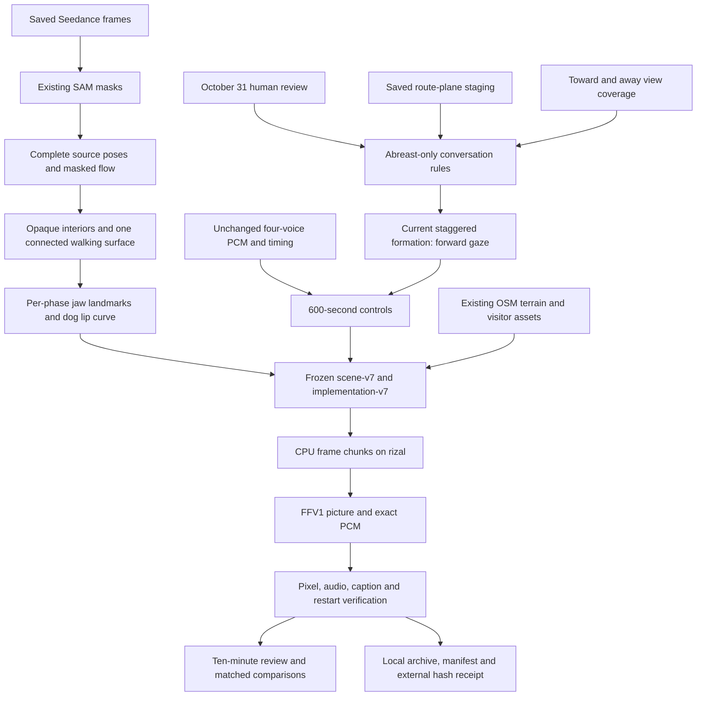
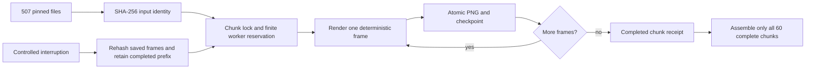
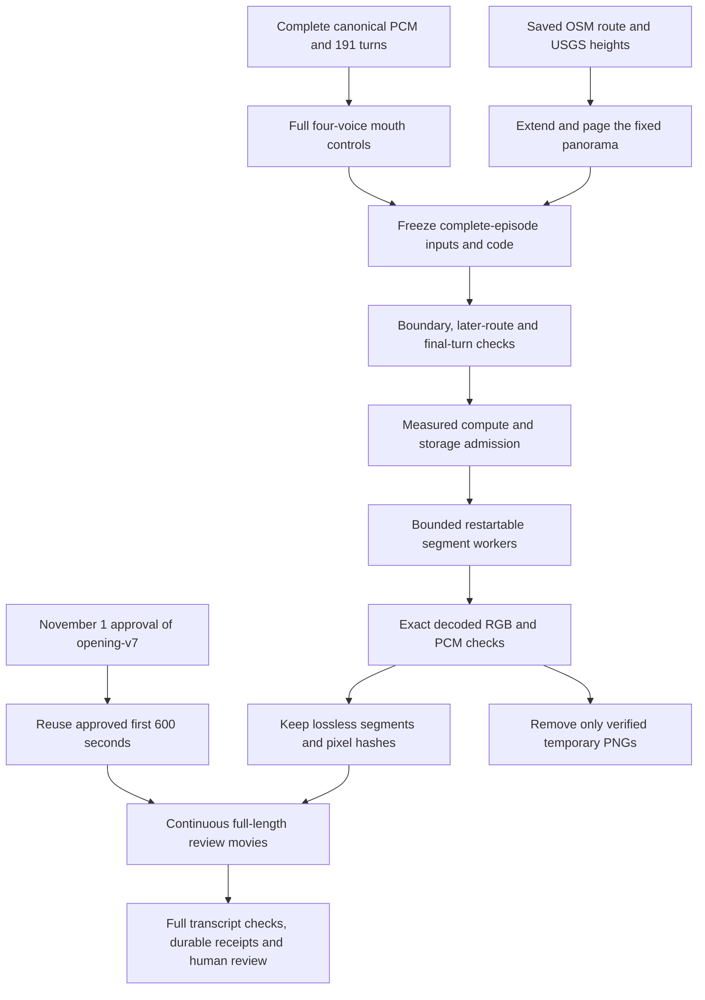

# Here Lies Trouble: local Stage 5 durable workflow

Filename date: October 30, 2026. Revision begun October 31, 2026.
Repository: `/home/bkoz/src/izzi`. Render host: rizal.

**Current status: opening-v7 approved; the complete 52:35.375 episode is delivered for full-length human review.**

November 17 public review: [watch the complete local film](https://situationshipin.space/review/here-lies-trouble-local-full-20261117/)
and [review this durable workflow](https://situationshipin.space/review/here-lies-trouble-local-stage5-workflow-20261117/).
The 720p review derivative retains the complete picture sequence and source AAC
dialogue. English captions are selectable. This publication does not change
the full-film human-review status or replace the preserved production masters.
Opening-v6 remains the preserved baseline. The final sections record production
and archive receipts after their respective verification steps complete.

The November 1 approval supersedes the earlier pending visual-review status
in this document and in the immutable October 31 receipts. The accepted v7
film includes its documented forward attention and source-occlusion limits.
Approval authorizes animation of the entire canonical transcript with this
treatment. It does not imply that the new full-length delivery has already
been rendered or reviewed. See the complete-episode continuation at the end.

## Human review and authorized revision

The human rejected the simultaneous camera-facing gaze in opening-v6. The
requested behavior is conversation between neighbors walking side by side:
look toward one another when actually abreast; keep looking forward when one
is ahead or behind. Approval of that algorithm is not visual acceptance of a
new film. The unicorn jerks; cat/dog gait timing is good, but body/leg and matte
joins remain visible. Preserve the accepted scenery, route, incidental animals,
dialogue and useful existing bird treatment.

The exact review and execution request are stored in
`resources.static/here-lies-trouble/local-rendering-stage-5/review-and-revision.20261031.json`.
Implementation proceeds independently as opening-v7, with short checks before
the authorized ten-minute revision and no new paid generation. Never modify
the frozen opening-v6 assets, code, media or archive in place.

## Root causes established from code and source inspection

1. Every v6 listener inherited the same speech-relative 7.6-second glance
   clock, offset by only 0.18 seconds per animal. Every turn used the same
   profile-to-front atlas; target labels did not supply the missing away view.
2. The unicorn's 22-frame source selection did not contain a matching full
   stride. Its last pose was interpolated back to a substantially different
   first pose. A source-cycle search finds a better 36-frame selection.
3. Optical flow used RGB outside the source alpha mask, allowing the moving
   scenery to influence interpolation. Disagreeing limbs became translucent
   double edges. The detached neutral head also introduced a moving neck join.
4. Some unicorn limb pixels were genuinely hidden by the source dog/cat.
   Segmentation and opaque masks cannot recover observed anatomy there;
   existing explicit occlusion completions remain reviewable approximations.

## Selected implementation

- Use complete walking surfaces with their attached neutral heads, applying
  speech motion to the lower jaw in that same image. Preserve dog/cat cycle
  lengths: 35 and 18 output frames. Use unicorn source frames 5–40 as a
  complete 66-output-frame cycle, matching the shared travel speed.
- Compute flow on masked animal RGB over a neutral field. Use an opaque
  interior silhouette and repair narrow matte cracks/edge contamination.
- Evaluate conversation eligibility using authored ground-contact roots,
  longitudinal position and neighboring trail lanes, not eye height.
- Select at most one speaker/listener pair, with individual glance timing.
  Require reciprocal toward/away view coverage. With the existing staggered
  staging, forward attention is the expected result. Unsupported turns stay
  forward rather than substituting a camera-facing pose.

The saved source library supplies profile-to-camera turns, not reciprocal
away-from-camera views. This revision can stop incorrect group camera turns;
it does not invent missing head surfaces or silently claim mutual eye contact.

## Working paths and commands

All paths below are relative to
`outputs/here-lies-trouble/local-rendering-stage-5-performance-20261030/`.

| Purpose | Path |
|---|---|
| Preserved v6 | `opening-v6`, `scene-v6`, `implementation-v6` |
| New development candidate | `opening-v7-dev`, `scene-v7-dev`, `implementation-v7-dev` |
| Frozen selected candidate | `opening-v7`, `scene-v7`, `implementation-v7` |
| Source/cycle investigation | `v7-audit/` |
| Existing full audio receipt | `audio-review/publication-live.json` |

```bash
python3 scripts/hlt-local-stage5-v7-prepare.py setup
python3 scripts/hlt-local-stage5-v7-prepare.py atlases
python3 scripts/hlt-local-stage5-v7-prepare.py mouths
python3 scripts/hlt-local-stage5-v7-prepare.py controls
python3 scripts/hlt-local-stage5-v7-run.py sync
python3 scripts/hlt-local-stage5-v7-check.py --dev
python3 scripts/hlt-local-stage5-v7-run.py canaries --dev
python3 scripts/hlt-local-stage5-v7-canary.py
```

Preparation writes development paths only. A changed development identity
requires a fresh canary job directory; preserve previous trials and receipts.
The selected candidate has already been frozen. Do not run `freeze` again on
these paths. The production and restore commands below use the selected copy.

The editable orchestration lives in `scripts/`; the selected pixel renderer
lives in `implementation-v7/`. The important entry points are:

| Source file under `scripts/` | Responsibility |
|---|---|
| `hlt-local-stage5-v7-probe.py` | Audit saved unicorn source cycles |
| `hlt-local-stage5-v7-prepare.py` | Build development surfaces, jaw landmarks and controls |
| `hlt_local_stage5_v7_gaze.py` | Abreast geometry, reciprocal-view requirements and event timing |
| `hlt_local_stage5_v7_art.py` | Complete walking surfaces and local speaking-jaw patches |
| `hlt-local-stage5-v7-run.py` | Sync development code, freeze, admit, render, verify and recover |
| `hlt-local-stage5-v7-check.py` | Canonical inputs, silhouettes, landmarks and conversation-policy fixtures |
| `hlt-local-stage5-v7-canary.py` | Short development comparison page and clips |
| `hlt-local-stage5-v7-deliver.py` | Final captions, films, comparisons and review page |
| `hlt-local-stage5-v7-delivery-check.py` | Media counts/durations, captions, links and freshly hashed frozen inputs |
| `hlt-local-stage5-v7-state.py` | Current state and preserved candidate history |
| `hlt-local-stage5-v7-package.py` | Local restart archive and full member verification |
| `hlt-local-stage5-v7-complete.py` | Ordered post-render delivery, documents, state and archive |

During sync, the v7 art source becomes the frozen file
`implementation-v7/hlt_local_stage5_art.py`. It reuses saved v6 helpers through
`hlt_local_stage5_v6_art.py`; the selected worker is
`implementation-v7/hlt-local-stage5-worker.py`. That worker inherits the
existing file-locked CPU ledger from the frozen Stage 4 worker. Editing a
similarly named repository script after freezing does not change selected
rendered pixels. A future change needs a new frozen identity and candidate.

## Exact production identity and inputs

The selected identity is
`f7f23d0ca28dedb822e78de558b730094ff2fef52068ba815fc88257a1d7acab`.
`opening-v7/review/input-identity.json` pins **507 code/input/asset paths**,
including **13 frozen Python files**. Delivery rehashes those paths. A
different input, image, registration or implementation requires a new candidate;
do not edit files beneath `scene-v7`, `implementation-v7` or the run's inputs.

| Input | Exact location or identity | Use |
|---|---|---|
| Canonical text | `outputs/transcription-enrichment/here-lies-trouble/here-lies-trouble.20261026.fourth-draft.txt` | Words and source offsets; keep BOM/CRLF when applying offsets |
| Text SHA-256 | `889c2fdd91008e7acd998a7ed1ab94c4a0a20e71c5cba06ec37070e47001f4f6` | Canonical identity |
| Complete audio | `outputs/here-lies-trouble/stage-4-20261026-option-b-v3/dialogue-master.wav` | Existing four-voice master; no speech regeneration |
| Complete audio SHA-256 | `efc0ad9a7bdf1bd39a47003db860c4efc9d6659b912e6c32d22f66aa1d000cec` | 52:35.375, stereo 48 kHz, 24-bit PCM |
| Canonical timeline | Same production directory, `timeline.json` | Speaker/turn timing and source offsets |
| Timeline SHA-256 | `dddbd3a6b4cc32da77a235bef0ea40958f4401a2c89093be62f9c3956075bf70` | Unchanged timing |
| Exact ten-minute audio | `opening-v7/inputs/dialogue.wav` | Byte-identical copy of the verified v6 excerpt |
| Excerpt WAV SHA-256 | `aee65d5e704b27deb4a0287b97f444817cba5063ab49e9f6d153ceb9863de4eb` | 28,800,000 stereo sample frames |
| Canonical visual source | `outputs/here-lies-trouble/stage-4-20261026-option-b-v3/review/sequence-silent.mp4` | Saved 103-second Seedance footage; no new provider job |
| Compiled controls | `opening-v7/performance.json` | 14,400 frame controls at 24 fps |
| Source library | `scene-v7/assets/source-pose-bank.json` | Pose paths, source frame/time/hash, completion records and per-phase jaw landmarks |
| Formation | `opening-v7/inputs/staging.json` | Saved positions through 102.958 seconds; final formation held afterward |
| Conversation rules | `opening-v7/inputs/gaze-policy.json` | Ground-contact roots, lane/longitudinal thresholds and source-view coverage |
| Terrain | `opening-v7/inputs/route-terrain.json`, `scene-v7/assets/scenery-v6.json` | Saved OSM route/USGS elevation trend and fixed spatial panorama |
| Visitors | `opening-v7/inputs/wildlife-events.json` and inherited drawing helpers | Existing event timing and artwork |
| Avian motion | `opening-v7/inputs/seagull-wing-coefficients.json` and frozen helpers | Retained bird wing/body/contact system |

The four speaker assignments remain:

| Speaker | Animal | Existing voice |
|---|---|---|
| 1 | Unicorn | `af_bella` |
| 2 | Dog | `am_echo` |
| 3 | Albatross | `af_nicole` |
| 4 | Cat | `af_heart` |

Inherited `dog-walk-cycle.json` and `cat-gait-parameters.json` remain as source
history. V7's quadruped pose clocks come from the compiled source-pose bank;
those older biomechanical parameters do not drive a separate leg mesh.

## Walking surfaces, cadence and mouth registration

| Animal | Saved source bank and frames | Output cycle | Why |
|---|---|---|---|
| Unicorn | `sam-poses/opening-6s`, original frames 5–40 inclusive | 66 frames / 2.750 s | Complete matching stride selection instead of the truncated 22-frame source loop |
| Dog | Same bank, frames 11–28 | 35 frames / 1.458 s | Preserve accepted gait phase order and cadence |
| Cat | `sam-poses/cat-clean-11s`, frames 266–276 | 18 frames / 0.750 s | Preserve accepted gait phase order and cadence |
| Albatross | Existing selected artwork and frozen avian functions | Existing flight/contact schedule | Preserve the reviewed bird treatment |

The source unicorn's stance displacement is approximately 8 pixels per source
frame. Retiming 36 source frames into 66 output frames gives approximately
`8 × 36 / 66 × 24 = 104.73` pixels/s against 105-pixel/s scenery travel.
This is a source-image calibration, not a recovered 3D gait measurement.

Each output quadruped is one complete RGBA walking pose, including its neutral
head, neck, torso and visible limbs. There is no detached neutral head pasted
over a moving neck and no independently composited leg rectangle. All 119
selected cycle phases have one connected foreground component at alpha >128,
with fully opaque interiors more than two pixels inside the silhouette.

Preparation computes bidirectional Farneback flow on masked animal RGB over
a uniform gray field. It warps premultiplied color/alpha, selects a single
material silhouette, closes only narrow three-pixel cracks, fills enclosed
holes no larger than 24 pixels, and removes detached fragments below 256 pixels.
Large spaces between legs stay open. A 0.45-pixel Gaussian edge softens the
outline without making limb interiors translucent. Bright contamination on
dark lower limbs is replaced only where an observed dark animal pixel lies
within eight pixels; per-phase pixel counts are saved in `atlas-audit.json`.

The unicorn still contains explicit short completions where the source dog
or cat hid a limb. Those pixels are approximations, not newly observed anatomy.
Removing small detached fragments avoids floating hoof flecks; it does not
prove that every hidden hoof has been anatomically reconstructed.

The walking head's lower lip is registered separately from the old detached
head atlas. The dog uses a six-point curve along its actual smile. Unicorn and
cat use their lower-muzzle endpoints. Masked flow transports these landmarks
through each pose cycle. Mouth changes are confined to a small jaw rectangle,
which replaces the corresponding pixels directly. Remapping or compositing
the whole body during speech would perturb unrelated antialiased edges.

The four existing speech envelopes are preserved exactly. Mouth apertures
remain energy-driven, with the prior silence gating and discrete opening
levels; this is not phoneme synthesis. Only the active speaker's mouth opens.

The comparable solid-background cycle audit reports:

| Animal | V6 seam / median adjacent change | V7 seam / median adjacent change |
|---|---:|---:|
| Unicorn | 2.610 | 1.395 |
| Dog | 1.543 | 1.533 |
| Cat | 0.960 | 0.961 |

These measurements identify the reduced unicorn discontinuity while showing
the dog/cat cadence was retained. They do not establish naturalness at normal
speed. The exact method and values are in
`opening-v7/review/like-for-like-cycle-comparison.json`.

## Conversation behavior and its current limit

Travel runs toward image-right. Authored roots near each animal's torso/ground
contact define longitudinal progress and lane depth. Eye height is excluded:
a tall unicorn and a small dog can occupy neighboring lanes without their
eyes sharing a screen row.

Two grounded actors can be a conversation pair only when their longitudinal
separation is less than 60 pixels and their lane separation is 12–130 pixels.
The turn weight fades between 40 and 60 longitudinal pixels. Geometry is
reevaluated every frame. An existing eligible partner is retained to prevent
rapid switching; otherwise the nearest eligible partner is chosen. Everyone
outside that single pair remains forward. Speaker/listener glance events use
different onset/return times and deterministic per-turn seeds.

The thresholds and root registrations are compiled from
`hlt_local_stage5_v7_gaze.py` and the preparation script. `gaze-policy.json`
records those decisions; it is not a live configuration file. For a new
candidate, change the compiler deliberately and regenerate `performance.json`
before freezing, rather than editing only the policy receipt.

An actual pair requires a toward-camera view for its farther member and an
away-from-camera view for its nearer member. The source library has only the
former. Missing reciprocal coverage keeps both neutral. The current renderer
also rejects an unexpected active turn rather than silently substituting a
frontal atlas. Adding views requires a new candidate and a registered reciprocal
head renderer; changing a coverage flag alone is insufficient.

The unchanged ten-minute formation contains **zero eligible abreast pair
frames**. All 14,400 controls therefore retain forward gaze, including silence.
There are no synchronized camera turns or scripted wildlife-directed turns.
The incidental animals themselves retain their accepted event animation.
Synthetic policy fixtures demonstrate pair eligibility, ahead/behind exclusion,
missing-view rejection and independently timed reciprocal events; those fixtures
are not footage proving mutual eye contact.

## Retained scenery, route and bird behavior

V7 preserves 99 non-quadruped asset files byte for byte. The 67,072×1,280
panorama, sky, trail surface and foreground use the existing spatial renderer.
The panorama camera starts at x=280 and advances at 105 pixels/s; ground and
foreground share that clock. There is no timed background dissolve. The sky
motif remains fixed, as in the accepted baseline.

The saved route begins near the Runyon Canyon trail location previously
specified by the human. The existing OSM route and USGS elevations guide an
illustrated scene, approximately 428.298 metres into the route at ten minutes.
This is not a photographic reconstruction. V7 performs no new map fetch and
uses no Google map imagery. The panorama SHA-256 is
`19e90feb5ed81552fa53046423c9615898de954ef555423ae0e85b94df4471ba`.

The albatross still approaches at 49–51.5 s, rides at 51.5–56.3 s, crouches at
56.3–56.8 s, pushes off at 56.8–57.15 s and departs through 59.5 s. Its contact
point follows the selected unicorn back contour. Wing and mouth treatment are
retained. No extra visitor or landing events are invented for the extension.

## Software, hosts, AI and data usage

| Component | Version / host | Role in this revision |
|---|---|---|
| Host | rizal, Linux `7.2.11-200.fc44.x86_64`, glibc 2.43 | CPU preparation, rendering, encoding and local archive |
| Python | 3.14.8 | Control compilation, workers, state and receipts |
| NumPy / SciPy | 2.4.6 / 1.16.2 | Image arrays, masks and distance operations |
| Pillow | 12.3.0 | PNG surfaces, compositing, jaw patches and review sheets |
| OpenCV | 4.13.0 | Masked optical flow, remapping and component checks |
| FFmpeg / FFprobe | 8.1.3 | FFV1/PCM master, H.264/AAC reviews, exact decode and media checks |
| Review fonts and shaping | FreeSans / DejaVu Sans; libass 0.17.4, FriBidi 1.0.16, HarfBuzz 14.1.0 | Comparison labels and burned captions; actual font files, hashes and licenses saved under `v7-audit/` |
| Codex | This implementation session | Code, diagnosis, authored registrations, documentation and internal still inspection |
| Saved Seedance footage | Existing production Stage 4 reference | Quadruped appearance and observed gait poses |
| Saved SAM 2.1 masks | V6 extraction on rizal CPU | Reused segmentation; no new model inference in v7 |
| Saved MOSS artwork | Earlier selected bird/scenery assets | Reused illustrated surfaces |
| GitHub Pages | Existing situationshipin.space deployment | Already-published full audio review |

There is no database server in this renderer. JSON files carry controls,
metadata, maps, state and receipts; PNG files carry compiled poses and frames;
WAV/MKV/MP4 files carry media. The exact Codex backend/model revision was not
captured, and is not a dependency for replaying the saved implementation.

No LLM, image model, provider account, GPU or network is called while replaying
the compiled film. Optional future rematting can use the saved SAM checkpoint
`sam2.1_hiera_small.pt`, SHA-256
`6d1aa6f30de5c92224f8172114de081d104bbd23dd9dc5c58996f0cad5dc4d38`,
source revision `2b90b9f5ceec907a1c18123530e92e794ad901a4`.
Its source/model provenance and license files are saved under `models/`.
Re-extraction is not required for exact compiled replay.





## Resource admission and selected canary

The selected canary covers 0–6, 18–21 and 42–45 seconds: **288 frames** in
**60.324 seconds** of frame-worker time. It projects **3,016.214 seconds**
for 14,400 frames. With a 10% frame margin, 15% margin on measured v6 assembly,
and 410 seconds for verification/recovery, the forecast is **4,320.796 seconds**.
At admission the shared ledger had **5,254.299 seconds** remaining from its
original 21,600-second limit. It was not reset.

The ledger is
`outputs/here-lies-trouble/local-rendering-stage-3-opening-20261028/cpu-budget.json`.
Each worker action reserves at most 900 seconds under a serial file lock and
charges measured elapsed time. An external kill can retain its reservation;
reconcile evidence rather than clearing a charge or resetting the allowance.
Frame work, technical preflight, master/proxy encoding, exact verification and
restart proofs are charged. Source preparation, review-only derivatives,
documentation and archive construction follow the inherited separate delivery
scope. Saved receipts record measured timings.

Earlier internal trials remain under `opening-v7-dev/jobs/canaries-*` with
their receipts. `opening-v7/review/internal-canary-history.json` distinguishes
those trials from the selected canary. New paid credits, model generations and
training attempts in this revision are all zero.

## Resume, verify and restore

First read `v7-continuation.json`, `v7-completion.json` and
`opening-v7/readiness.json` under the Stage 5 output root. An active session
and current heartbeat mean the job is still running. Recorded PIDs belong to
the execution namespace; do not treat them as host-wide process identifiers.
Avoid starting another worker over a live job. Locks enforce serial admission.
The frame heartbeat stops advancing during encoding and media verification.
At 14,400 completed frames, also inspect the active execution session, worker
reservation, partial media and verification receipts before deciding a run
has stalled. A stale frame heartbeat alone does not establish a stopped encoder.

From `/home/bkoz/src/izzi`, a partially completed selected run resumes with:

```bash
python3 scripts/hlt-local-stage5-v7-run.py full
python3 scripts/hlt-local-stage5-v7-complete.py
```

`full` verifies saved chunk/frame hashes and keeps completed frames. Each
240-frame chunk has a request identity, atomic per-frame checkpoint and final
receipt. A changed identity is rejected. It assembles the complete 14,400-frame
set, encodes the master/review MP4 and verifies the result. The completion
command requires the full render to have passed. `--wait` may supervise an
already-running authorized render; it does not authorize future work.

Individual completion commands, when needed for a known interrupted step:

```bash
python3 scripts/hlt-local-stage5-v7-run.py verify
python3 scripts/hlt-local-stage5-v7-run.py recover
python3 scripts/hlt-local-stage5-v7-deliver.py
python3 scripts/hlt-local-stage5-v7-delivery-check.py
python3 scripts/hlt-local-stage5-v7-state.py --final
python3 scripts/hlt-local-stage5-v7-package.py
python3 scripts/hlt-local-stage5-v7-state.py --final
```

Do not repeat expensive checks after a completed receipt without a reason.
The full lossless check decodes four 3,600-frame sections and compares every
RGB frame with its saved pixel hash. PCM comparison checks all 28,800,000
stereo sample frames. Captions retain canonical words, case, punctuation and
source offsets; ASR supplies timing only. A listening MP4's AAC is a derivative,
not the bit-identical PCM evidence.

For an archive restore, place its members beneath the same Stage 5 output
directory in an izzi checkout. `opening-v7/assets` must resolve to
`../scene-v7/assets`. Restore missing scripts/resources from `recipe-v7` at
their repository-relative paths. Restore the canonical/reference subdirectory
to `outputs/here-lies-trouble/stage-4-20261026-option-b-v3/` when regenerating
captions/comparisons. The prior v6 review movie has a separate recipe copy.

For optional source rebuilding, `recipe-v7/previous-v6-build-inputs` contains
the v6 scene, implementation and input files needed by the preparation scripts.
Restore those folders to the Stage 5 output root only when absent. Compiled v7
replay does not need them. Preserve newer existing files and the newer live
CPU ledger; never overwrite an updated allowance with the archived snapshot.

Original frame PNGs and media provide exact saved results. Re-rasterization
should use the recorded library versions and be checked against saved pixel
hashes: different rasterizer/library versions can alter bytes. No regeneration
from a language or image model is needed to recover the selected result.

The archive contains the working assets and implementation, not an operating
system image or Python wheelhouse. A replacement host must supply the recorded
Python, NumPy, SciPy, Pillow, OpenCV and FFmpeg versions. The saved
`v7-audit/runtime-environment.json`, `runtime-package-provenance.json` and
`font-provenance.json` identify that environment, including the exact Fedora
package releases and FFmpeg build configuration. The two actual review fonts
and their licenses are included;
delivery uses the saved FreeSans file for labels and the saved font directory
for libass captions. Check decoded pixels and PCM after moving environments;
equivalent appearance is not evidence of identical raster output.

The review encoder makes H.264/AAC listening copies, while the FFV1/PCM master
retains the exact picture and sound. The captioned movie uses x264 `veryfast`,
CRF 17 and copied AAC from the clean review. Comparisons use CRF 18, matched
24-fps episode time and a single excerpt of canonical audio. Saved script
arguments and derivative receipts, rather than a fresh model prompt, define
these outputs. Encoding the same pixels with a different FFmpeg build may
produce different compressed bytes; the archived media remain the exact
original deliverables.

For another evolution, copy the selected run/scene/implementation to new names,
update the controller deliberately, and retain all original receipts. Do not
run development preparation against a delivered candidate. Acquire missing
head surfaces before enabling reciprocal turns. Validate a short walking and
speaking example, inspect it at normal speed, then calculate resource admission
for a longer render.

## Complete audio review

The [complete fourth-draft listening review](https://situationshipin.space/review/here-lies-trouble-draft4-complete-audio-20261030/)
remains published alongside the
[canonical screenplay](https://situationshipin.space/review/here-lies-trouble-fourth-draft-20261026/).
It is 52:35.375 long. No words, order, pauses or voices were edited for v7.
The mono 24-kHz/40-kbit/s MP3 is a bounded listening derivative; the full
lossless stereo master remains local. The publication receipt records site
commit `99f3696`, live HTTP checks and a matching downloaded media hash.

MP3 SHA-256:
`8608e5939b15fc9d814f3425284c45391a5e5a75eb9adb2c44ba7bd2cda8c3ce`.
No new website publication is needed for unchanged audio.

## Open human review

- Unicorn stride continuity, stance sliding and hidden-limb completion.
- Dog/cat shoulder, hip, neck and paw surfaces at normal and slow speed.
- Forward gaze in the current staggered formation; future reciprocal turns
  require actual away-view assets and a separate visual canary.
- Correct mouth placement on the walking head across each complete cycle.
- Retained bird contact, foreground, terrain and visitor appearance.
- Bird toe placement, folded wings and push-off articulation at 49–59.5 seconds.
- Repeated walking cycles and reused scenery textures across ten minutes;
  the available Seedance comparison covers only the first 103 seconds.

Implementation and exact-media checks do not establish visual approval.

The implementation session inspected nine production stills at 0, 6, 19, 42,
52, 57, 60, 103 and 150 seconds. Those samples show forward attention and
attached dog/cat surfaces, with the sampled bird contact following the unicorn
back. Unicorn lower-limb completions remain approximations. These are bounded
still-image observations, not a claim of human normal-speed approval. See
`v7-audit/early-production-contact.jpg` and
`v7-audit/early-production-samples.json` for the exact sampled PNGs and hashes.
Four later samples at 420, 480, 540 and 599.958 seconds retain the same forward
attention and connected dog/cat surfaces, with panorama coverage through the
final frame. Their bounded observations and hashes are in
`v7-audit/late-production-body-samples.json`, with the corresponding contact
sheet alongside it. They leave normal-speed motion and hidden-hoof naturalness
open for human review.


## Completed production results

Recorded 2026-11-01T05:23:00.471568+00:00.
Open the [ten-minute review player](../../../outputs/here-lies-trouble/local-rendering-stage-5-performance-20261030/delivery/opening-v7/index.html),
the [clean film](../../../outputs/here-lies-trouble/local-rendering-stage-5-performance-20261030/delivery/opening-v7/opening-clean.mp4),
or the [v6/v7 comparison](../../../outputs/here-lies-trouble/local-rendering-stage-5-performance-20261030/delivery/opening-v7/v6-v7-comparison-60s.mp4).

| Verified result | Value |
|---|---|
| Picture | 600 seconds, 14,400 frames, 1080×1920, 24 fps |
| Lossless decoded frames | All 14,400 RGB frames match production pixel hashes |
| Audio | 28,800,000 stereo 48-kHz PCM sample frames, identical to the canonical prefix |
| Captions | 1413 canonical tokens, 141 cues; case/punctuation retained |
| Frozen inputs freshly rehashed | 507 code/input/asset paths |
| Frame worker time | 2909.622 seconds across 60 chunks |
| Master/proxy assembly elapsed | 526.161 seconds |
| Shared worker ledger | 20101.467 / 21,600 seconds |
| Remaining worker allowance | 1498.533 seconds |
| New provider credits / model generations / training | 0 / 0 / 0 |

Two controlled interruption tests stopped after 12 saved frames and resumed
24-frame jobs starting at frames 1,200 and 4,800. Completed prefix PNG bytes
and modification times were retained; all resumed PNG bytes match production.
Receipts: `opening-v7/review/restart-verification.json` and
`delivery/opening-v7/delivery-validation.json`.

- Input identity: `f7f23d0ca28dedb822e78de558b730094ff2fef52068ba815fc88257a1d7acab`.
- Lossless master SHA-256: `341f863fc6fcd4a95bcc22a9a2242acbf19fe7737208fea7cdb806a5dac28aa4`.
- Clean MP4 SHA-256: `296e5f3114350b733693042dcfe0e41f639f3cc0b265ac8ec3eca81e26f0464c`.
- Exact decoded PCM SHA-256: `0a23e55f1325e312ce906196af125f20438d20aae381aa981b84e49df6d3defb`.

The ten-minute endpoint falls inside speaker 3 / albatross turn 33, during
“doesn't” according to the saved timing. The complete canonical transcript
and full audio remain intact. This is an exact requested excerpt, not a rewrite.

Technical production is complete. The human-review items in this document
remain open; neither the software checks nor the unattended run establish
visual acceptance. The current staggered cast stays forward. No mutual
side-by-side look is claimed without the missing reciprocal view assets.


## Completed local restart archive

[Opening-v7 restart archive](../../../outputs/here-lies-trouble/local-rendering-stage-5-performance-20261030/delivery/opening-v7/opening-v7-local-bundle.tar) is
**46,020,853,760 bytes**, with **30,580 payload paths**
verified against their hashes. Construction and verification took
429.629 seconds.

SHA-256: `ca27d1fce34df994df95c6cd677ee805ee4384e7a18687bed16db9f2cdfed678`.

The [external archive receipt](../../../outputs/here-lies-trouble/local-rendering-stage-5-performance-20261030/delivery/opening-v7/bundle-verification.json)
and [member manifest](../../../outputs/here-lies-trouble/local-rendering-stage-5-performance-20261030/delivery/opening-v7/bundle-manifest.json)
identify the completed file. The archive is local; no independent-host copy
was made. Its documentation/state snapshot precedes this final hash, which
cannot be embedded into the file being hashed. Preserve the external receipt.

## November 1 approval and complete-episode production

The human explicitly approved this rendering and requested animation of the
entire transcript. The exact instruction, approved v7 identity and master hash
are recorded in
`resources.static/here-lies-trouble/local-rendering-stage-5/approval-and-full-production.20261101.json`.
The earlier visual-review notes describe accepted residual limitations of v7;
they are no longer approval gates for extending this treatment. The original
technical receipts, media and archive remain historical evidence, including
their then-pending approval fields. The new approval receipt is authoritative.

The complete episode is **52:35.375**, **75,729 frames at 24 fps**, with
**151,458,000 stereo 48-kHz sample frames**, **191 turns** and **297 speech
chunks**. Reuse the approved first **14,400 frames / 600 seconds** directly;
render the remaining **61,329 frames / 42:35.375**. Preserve the complete
canonical fourth-draft text, full PCM master and all four voice assignments.
The continuation completes the sentence previously intersected by the
ten-minute preview and runs through the final canonical turn and audio tail.

The new root is
`outputs/here-lies-trouble/local-rendering-stage-5-full-20261101/`, with
`episode-v1`, `scene-v1`, `implementation-v1` and `delivery/episode-v1`.
The v7 renderer and walking surfaces are copied unchanged. A small wrapper
changes only the scenery reader to load bounded panorama pages. Staging,
mouth treatment, forward attention, bird performance and the existing visitor
schedule carry through from the approved implementation. No new model
sampling, training, provider credits or purchases are used.

The saved OSM working route is 2,252.4 metres long. The same terrain construction
continues along its eight saved USGS elevation anchors using the existing
illustrated scenery sources. The camera, ground and foreground retain the
105-pixel/s clock. The first 64,356 panorama columns are compared exactly with
the accepted panorama, including every source pixel visible in the approved
ten-minute prefix. Additional tiles join spatially beyond that prefix; no timed
background dissolve or resetting scenery clock is introduced. The full atlas
is stored as 8,192-column pages so workers need only the visible neighboring
pages in memory. This remains an illustrated route, with the same geographic
precision limits documented above.

The compiled full atlas is **333,312 × 1,280 pixels in 41 pages**. Each worker
caches at most four decoded pages. `scene-v1/assets/full-route-panorama.json`
records every page hash and spatial tile's source, world x-coordinate, episode
time, route distance, interpolated longitude/latitude and centre elevation.
The extension uses the saved four terrain paintings, 1,280-pixel tile advances
and 512-pixel spatial overlaps. It follows the fixed source-selection order
and minimum-error seams in `hlt-local-stage5-full-prepare.py`; there is no new
random seed or model sampling. The first added tile starts at x=66,560, beyond
the 64,356 columns needed by the approved prefix. Saved USGS centre elevations
guide a two-pixels-per-metre vertical adjustment, with horizon alignment at
each overlap. Preserve the compiled pages for exact replay; reconstructing
them requires the recorded NumPy/OpenCV/SciPy environment and source assets.

The old six-hour exploration ledger remains at **20,101.467 / 21,600 seconds**.
Its remaining 24:58.533 cannot fund a full episode. This explicit new
complete-episode instruction authorizes a separate production run, recorded
in `local-rendering-stage-5-full-20261101/cpu-budget.json`, with a bounded
**28,800 aggregate active worker-second ceiling**. The initial agent-selected
six-hour planning bound did not pass the measured full-pipeline admission;
its failed admission receipt is retained as `resource-admission-initial-6h.json`.
The new-production ledger records that measured revision to eight hours. This does not reset or
increase the earlier exploration allowance, exhausted image allowance or
training allowance. Measure representative complete segment work before
admission; choose worker concurrency from those measurements and retain
finite reservations and measured elapsed charges, including failed work.

Storage is bounded by keeping verified FFV1/PCM segment masters. Each new
ten-second job first saves restartable PNGs, encodes its lossless segment,
decodes and compares every RGB frame and PCM sample, and then removes only
that job's temporary PNGs. The exact pixel hashes and lossless segment remain.
The approved ten-minute masters and review files are reused through hard links.
The full review is delivered as continuous clean and captioned MP4s with the
complete canonical audio encoded once per movie. A lossless segment manifest
and concat playlist define the full lossless master without duplicating its
large media payload into another monolithic file or archive.



Preparation and renderer sources are `scripts/hlt-local-stage5-full-prepare.py`,
`scripts/hlt_local_stage5_full_art.py` and
`scripts/hlt_local_stage5_full_worker.py`. The worker code used for production
is frozen beneath the new implementation directory. Full-length captions use
the saved word alignment and canonical source offsets; recognition text never
replaces canonical words. Final measured admission, delivery and restart
receipts will be appended after the corresponding checks complete.

### Measured full-production admission and continuation

The selected full-episode input identity is
`c8a891c7b0afc5d9263f913f23a0df9ca3c0203a39f4e310cb0daac7a1e3f9df`,
covering **563 frozen paths**. A total of **1,329 newly rendered canary frames**
passed exact segment checks and are reused in production. Seven sample frames
from the approved prefix also rendered identically through the paged scenery
reader, and all original 14,400 prefix controls are identical.

| Measured admission item | Value |
|---|---:|
| Serial complete segment work | 0.306606 active seconds/frame |
| Two workers, aggregate active work | 0.322817 seconds/frame |
| Three workers, aggregate active work | 0.336504 seconds/frame |
| Selected concurrency | 3 workers |
| Remaining new frames after canaries | 60,000 |
| Forecast with 15% segment margin and 1,800 seconds delivery allowance | 25,018.789 aggregate seconds |
| Worker allowance remaining at admission | 28,354.548 seconds |
| Additional storage forecast including margin and reserve | 105,963,933,451 bytes |
| Free storage at admission | 127,936,167,936 bytes |

The resource admission passed. The old six-hour planning rejection is retained
alongside the accepted receipt; no attempts or charges were erased. The
controller submits only three jobs at a time, updates completion state after
verified segments, then assembles and checks the complete review movies.
It uses Python's `ProcessPoolExecutor` with spawned processes. Each worker
keeps the frozen controls and pose cache, uses two OpenCV threads and two
FFmpeg codec threads, and retains the global episode frame number. Gait,
mouths, terrain and foreground clocks never restart at segment boundaries.
At most three 240-frame PNG scratch sets are live. Final review assembly
copies the already-encoded video streams and encodes the complete canonical
audio once for each continuous film; independently encoded segment AAC is
not joined into the final soundtrack.

The clean and captioned joins were separately remuxed and decoded across
599–601 seconds. All 48 frames in each test matched the corresponding source
review segments. Six-second clips covering 598–604 seconds are saved as
`episode-v1/review/continuation-join-clean.mp4` and
`continuation-join-captioned.mp4`. The continuation completes the word and
sentence at the old preview boundary; audio is supplied continuously from the
full canonical master. Internal still samples at 601, 1,251 and 3,154 seconds
show the accepted character treatment, full scenery coverage and legible
active captions. These checks do not replace review of the finished episode.

The lossless FFV1/PCM playlist also passed the same 48-frame boundary check,
plus exact comparison of 96,000 stereo samples spanning 599–601 seconds.
PCM identity uses integer sample indices after decoding. An earlier diagnostic
that sought the Matroska stream with `-ss 599` was not sample-exact; it was
replaced by `atrim=start_sample=28752000:end_sample=28848000`. The original
segment checks already compare their complete PCM ranges exactly. This
distinction and the successful playlist proof are recorded in
`episode-v1/review/lossless-join-verification.json`; the reproducible checker
is `scripts/hlt-local-stage5-full-join-check.py`.

Current progress is in this new root's `continuation.json` and
`episode-v1/readiness.json`; `execution-session.json` identifies the live tool
session. Resume a stopped production with
`python3 scripts/hlt-local-stage5-full-run.py run`. It verifies and reuses
completed segments, including the late-route canaries, before continuing.
The full runner also invokes delivery, final checks, documentation and state
recording when rendering completes. Keep the coordinator lock and ledger
reservations intact while it is live.


### Full-episode still inspection and remaining visual review

Twelve sampled clean-film frames cover 0:00, 9:59, 10:00, then five-minute
intervals through 50:00 and 52:34. The characters retain the approved scale,
forward staging and connected silhouettes; the terrain and foreground remain
covered through the final turn. Some extended terrain joins bend or pinch
the illustrated ridges, particularly around 20:00, 35:00 and 52:34. Review
those passages at normal speed for acceptable terrain shape and continuity.
The still inspection cannot establish gait, lip synchronization, gaze timing
or motion continuity throughout the movie. Its bounded observations are saved
in `episode-v1/review/full-episode-visual-inspection.json`; full-length visual
and listening review remains open.


## Complete episode delivered — November 1 production

Recorded 2026-11-01T15:45:38.484147+00:00.
Open the [complete episode review](../../../outputs/here-lies-trouble/local-rendering-stage-5-full-20261101/delivery/episode-v1/index.html),
the [clean film](../../../outputs/here-lies-trouble/local-rendering-stage-5-full-20261101/delivery/episode-v1/complete-clean.mp4),
or the [captioned film](../../../outputs/here-lies-trouble/local-rendering-stage-5-full-20261101/delivery/episode-v1/complete-captioned.mp4).

| Result | Verified value |
|---|---|
| Complete duration | 52:35.375 / 3,155.375 seconds |
| Picture | 75,729 frames, 1080×1920, 24 fps |
| Canonical sound | 151,458,000 stereo 48-kHz sample frames; full original PCM retained |
| Canonical speech | 191 turns, 297 chunks, 8,107 caption tokens |
| Captions | 800 cues, exact canonical words and punctuation |
| Approved prefix | First 14,400 frames / 600 seconds reused |
| Newly rendered | 61,329 frames / 42:35.375 |
| Lossless master | 257 ordered FFV1/PCM segments |
| Workers selected by measurement | 3 |
| New production ledger | 19885.428 / 28,800 aggregate worker seconds |
| Original exploration ledger | Unchanged; its recorded hash still matches |
| New provider credits / training / image inference | 0 / 0 / 0 |

Input identity: `c8a891c7b0afc5d9263f913f23a0df9ca3c0203a39f4e310cb0daac7a1e3f9df`. Every new segment's decoded RGB
frames and PCM samples matched the rendered pixel records and canonical audio
range before its temporary PNGs were removed. The prefix retains its approved
exact-media verification and was freshly hashed. Both complete review movies
decode to the expected 75,729 frames, retain the full duration, and use the
canonical audio continuously rather than joining independently encoded AAC.
All source intervals and turns are represented; the preview's cut sentence is
completed and the final turn and original audio tail are included.

The restart test stopped a 24-frame continuation job after 12 frames, resumed
without changing the saved prefix bytes or modification times, and matched
the corresponding production segment's pixel hashes. Its receipt is
`episode-v1/review/restart-verification.json`. Admission measurements and exact
input hashes are alongside it. The full review checks and lossless segment
manifest are under `delivery/episode-v1/`.

### Full-production restart and future evolution

From `/home/bkoz/src/izzi`, read this production root's `continuation.json`
and `episode-v1/readiness.json`. An active coordinator holds `coordinator.lock`.
Do not start a second coordinator over a live run. A stopped run resumes with:

```bash
python3 scripts/hlt-local-stage5-full-run.py run
```

Completed segment receipts are verified and reused; incomplete jobs preserve
their PNG checkpoints. Each active job has a finite reservation in the new
production ledger. Concurrent jobs reserve independently under a short ledger
lock, and all their elapsed charges count toward the same ceiling. A hard-killed
worker can leave a reservation; reconcile its recorded evidence rather than
resetting the allowance. An input or implementation change requires a new
candidate, not modification of the delivered episode.

The scripts below currently target the recorded `local-rendering-stage-5-full-20261101/episode-v1`
candidate; they are not generic commands that allocate a fresh candidate.
For an exact rebuild, use a separate checkout with the same relative layout
and restore its documented approved-v7 dependencies first. For an evolved
candidate in this checkout, select a new production root consistently in the
preparation, worker, coordinator, delivery, join-check and completion sources
before preparation and freezing. Keep the original frozen implementation,
receipts and ledgers intact. Then use this build sequence; do not run it over
the delivered candidate or repeat its canaries without a concrete reason.

```bash
python3 scripts/hlt-local-stage5-full-prepare.py all
python3 scripts/hlt-local-stage5-full-run.py canaries
python3 scripts/hlt-local-stage5-full-run.py measure
python3 scripts/hlt-local-stage5-full-run.py run
```

The full runner invokes `hlt-local-stage5-full-deliver.py assemble`, then
`verify`, followed by `hlt-local-stage5-full-complete.py`. Those individual
commands support a known interrupted delivery step. The approved v7 archive
contains the prior source library and optional preparation inputs; the new
recipe stores the compiled full-route assets, controls, exact full audio,
frozen implementation, fonts, receipts, current source scripts and this record.
The canary action includes the review and lossless join checks; `measure`
adds the recorded three-worker measurement and updates resource admission.

The full lossless master is represented by
`delivery/episode-v1/lossless-segment-manifest.json` and `lossless.ffconcat`,
with media under `episode-v1/jobs/segments/`. Preserve that directory as well
as the compact recipe archive. The recipe deliberately excludes those large
lossless/review media files to fit the available storage. It is sufficient to
regenerate them with the recorded environment and an appropriate future compute
allowance when combined with the preserved approved v7 archive or prefix media;
it is not a second stored copy of the complete film. Existing exact
pixel hashes provide the comparison for any regeneration.

For corruption of a completed segment, retain its damaged files and receipts
in a separately named quarantine, regenerate that same interval from immutable
inputs in a new job directory, and compare its pixels with the preserved
expected hashes before selecting the replacement. Do not treat a missing or
corrupt media file as a reason to reset source identities or old budgets.

The complete-episode visual/listening review remains open. In particular,
review long-duration repetition, the illustrated route continuation, the
ten-minute join, all speaker handoffs and the final sentence. The approved
unicorn source-occlusion approximations and forward-only staggered attention
remain the accepted baseline treatment, with future refinements optional.


### Verified complete-episode restart recipe

The [compact restart recipe](../../../outputs/here-lies-trouble/local-rendering-stage-5-full-20261101/delivery/episode-v1/complete-episode-restart-recipe.tar) is
1,407,088,640 bytes; 2,667 payload paths passed
member verification. SHA-256: `93f9ac516825cb2e08f86d0b6c195ad575bf84e3437a0d93a2bd8d8b3bc4344f`.
Large lossless segments and review movies remain separately under the full
production root; preserve them with the recipe and their manifest. This is a
local copy, with no independent-host duplicate. The external receipt is
`delivery/episode-v1/recipe-verification.json`. Its documentation snapshot
precedes this final hash and completion state.
